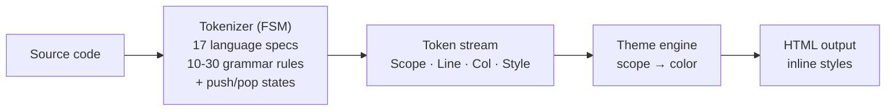

# CodeMate Core

A fast, zero-dependency syntax highlighting engine for Go — 17 languages, 10 themes, and an FSM-based tokenizer. Runs as a native Go library or compiled to WASM for the browser.

```go
hl := codematecore.NewHighlighter(codematecore.HighlighterOptions{})
html, _ := hl.CodeToHtml(`const x: number = 42;`, "typescript")
// → <pre style="..."><code>...</code></pre>
```

## Features

- **17 languages** — JavaScript, TypeScript, Python, Bash, C, C++, C#, CSS, Go, HTML, Java, JSON, Markdown, PHP, Rust, SQL, YAML
- **10 themes** — Dark+ (default), GitHub Light, Dracula, One Dark Pro, Nord, Monokai, Material Ocean, Tokyo Night, Solarized Dark, Solarized Light
- **No external dependencies** — pure Go standard library
- **Deterministic output** — same input always produces the same HTML
- **Thread-safe** — a shared `Highlighter` can be used concurrently from multiple goroutines
- **Golden-tested** — 51 token-stream fixtures verified against the TypeScript reference implementation
- **WASM support** — compile to WebAssembly for browser use
- **Token caching** — avoids re-parsing repeated input
- **Customizable** — per-call pre style, line class prefix, theme switching

## Usage

### Go API

```go
import codematecore "code-mate-core"

hl := codematecore.NewHighlighter(codematecore.HighlighterOptions{})

// Get token stream
tokens, err := hl.CodeToTokens("def hello(): pass", "python")

// Render HTML
html, err := hl.CodeToHtml("def hello(): pass", "python")

// With options
html, err := hl.CodeToHtml("const x = 1;", "javascript",
    codematecore.WithPreStyle("background: #1E1E1E; padding: 12px;"),
    codematecore.WithLineClassPrefix("ln-"),
)

// Switch theme
if err := hl.UpdateTheme("github-light"); err != nil {
    // handle unknown theme
}
```

### Custom Highlighter

```go
hl := codematecore.NewHighlighter(codematecore.HighlighterOptions{
    Theme:           "github-light",
    PreStyle:        "background: #fff; padding: 16px;",
    LineClassPrefix: "line-",
})
```

> Unknown theme names or invalid theme values fall back to the default theme (`dark-plus`).

### WASM (Browser)

```go
// Build
GOOS=js GOARCH=wasm go build -o coder-mate.wasm ./cmd/wasm/
```

```html
<script src="wasm_exec.js"></script>
<script>
  const go = new Go();
  WebAssembly.instantiateStreaming(fetch("coder-mate.wasm"), go.importObject)
    .then(result => {
      go.run(result.instance);

      // Quick highlight
      const r = coderMateHighlight("const x = 1;", "javascript");
      document.body.innerHTML = r.html;

      // Multi-instance API
      const id = coderMate.createHighlighter({ theme: "github-light" });
      const r2 = coderMate.highlight(id, "print('hi')", "python");
      coderMate.updateTheme(id, "dark-plus");
      coderMate.dispose(id);
    });
</script>
```

### WASM JS API Reference

| Function | Description |
|----------|-------------|
| `coderMateHighlight(code, lang)` | Highlight with default instance, returns `{ html }` |
| `coderMate.createHighlighter(options)` | Create instance, returns numeric ID |
| `coderMate.highlight(id, code, lang)` | Highlight with specific instance |
| `coderMate.updateTheme(id, theme)` | Switch theme on an instance |
| `coderMate.dispose(id)` | Release instance memory |
| `coderMate.getThemes()` | List available themes |
| `coderMate.getLanguages()` | List available languages |

Options for `createHighlighter`: `theme` (string), `preStyle` (string), `lineClassPrefix` (string).

## Supported Languages

| ID | Aliases |
|----|---------|
| `javascript` | `js` |
| `typescript` | `ts` |
| `python` | `py` |
| `bash` | `sh`, `shell` |
| `c` | `h`, `c89`, `c99`, `c11` |
| `cpp` | `c++`, `cc`, `cxx`, `hpp`, `hxx`, `hh` |
| `csharp` | `cs`, `c#` |
| `css` | |
| `go` | `golang` |
| `html` | `htm` |
| `java` | `jav` |
| `json` | |
| `markdown` | `md` |
| `php` | `phtml`, `php8` |
| `rust` | `rs` |
| `sql` | `postgresql`, `pgsql` |
| `yaml` | `yml` |

## Themes

| ID | Display Name |
|----|-------------|
| `dark-plus` | Dark+ (default) |
| `github-light` | GitHub Light |
| `dracula` | Dracula |
| `one-dark-pro` | One Dark Pro |
| `nord` | Nord |
| `monokai` | Monokai |
| `material-ocean` | Material Ocean |
| `tokyo-night` | Tokyo Night |
| `solarized-dark` | Solarized Dark |
| `solarized-light` | Solarized Light |

## Architecture



The tokenizer uses a **finite state machine** with push/pop state stack. Each language defines grammar rules per state, and rules are matched in priority order. Cross-line tokens (e.g. multi-line strings) are handled by persisting state across line breaks.

## Performance

Benchmarked on **12th Gen Intel Core i7-12700** (Windows, Go 1.26.5):

```
BenchmarkParse_JavaScript-20           2,836    406,793 ns/op   102,509 B/op   1,401 allocs/op
BenchmarkParse_Python-20               3,640    352,565 ns/op    75,586 B/op   1,093 allocs/op
BenchmarkParse_MultiByte-20            4,050    302,313 ns/op    74,928 B/op   1,075 allocs/op
BenchmarkCodeToHtml_SmallJS-20       214,309      4,978 ns/op     5,176 B/op     52 allocs/op
BenchmarkCodeToHtml_Python-20         10,000    161,464 ns/op   138,878 B/op   1,117 allocs/op
BenchmarkCodeToHtml_LargeJS-20         5,191    211,746 ns/op   182,627 B/op   1,429 allocs/op
BenchmarkCodeToHtml_MultiByte-20       6,559    163,952 ns/op   137,984 B/op   1,087 allocs/op
BenchmarkCodeToHtml_Parallel-20       14,452     85,661 ns/op   182,960 B/op   1,431 allocs/op
BenchmarkCodeToHtml_CacheHit-20        5,164    220,985 ns/op   182,577 B/op   1,429 allocs/op
BenchmarkParse_EmptyCode-20         61,157,091         22.7 ns/op       16 B/op      1 allocs/op
BenchmarkParse_SingleChar-20         1,510,675        803.9 ns/op      303 B/op      8 allocs/op
BenchmarkParse_ManyShortLines-20        68,078     17,472 ns/op     5,335 B/op     95 allocs/op
BenchmarkUpdateTheme-20              12,128,991       101.8 ns/op       0 B/op      0 allocs/op
```

- **~0.4 ms** to parse and highlight a ~30-line JavaScript file
- **~5 μs** for a small `const x = 1;`
- **~23 ns** for empty input (near-zero overhead)
- **Multi-byte (CJK) input** handled without extra overhead — Chinese identifiers/comments/strings parse at the same cost as ASCII
- **Concurrent access** on one shared `Highlighter`: ~86 μs/op across 20 threads (`-20` = GOMAXPROCS), safe without external locking
- **Cache hit** matches the full pipeline cost — the cache avoids re-parsing, while token clone + re-render dominate
- **Theme switching** is near-free (~100 ns, zero allocations)

### Go WASM vs JS Version

Compared to the [JS version](https://github.com/belos-street/coder-mate-core-js) of the same engine (same CPU, same algorithm):

| Metric | JS (Bun) | Go WASM | Speedup |
|--------|----------|---------|---------|
| JavaScript ~100 lines (full pipeline) | 7.79 ms | ~0.55 ms | **~14x** |
| Python ~120 lines (full pipeline) | 8.36 ms | ~0.84 ms | **~10x** |
| Single small expression | ~0.05 ms | ~0.004 ms | **~12x** |

The Go WASM build runs **10-15x faster** than the equivalent JS bundle for browser-side syntax highlighting, while producing identical token output.

Run benchmarks yourself:

```bash
# Go benchmarks
go test -bench=. -benchmem -count=1 ./benchmark/

# JS benchmarks
git clone https://github.com/belos-street/coder-mate-core-js
cd coder-mate-core-js && bun install
bun run bench:js-language
```

## Related Projects

- [coder-mate-core-js](https://github.com/belos-street/coder-mate-core-js) — The original TypeScript version with the same FSM-based tokenizer, supporting 17 languages and 10 themes. Serves as the reference implementation and is suitable for Node.js / Bun environments.

## Requirements

- Go 1.23+
- No external dependencies

## License

MIT
